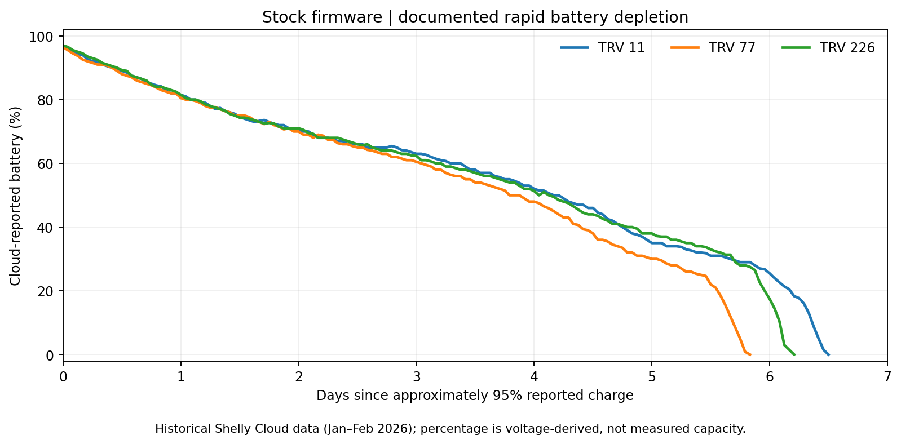
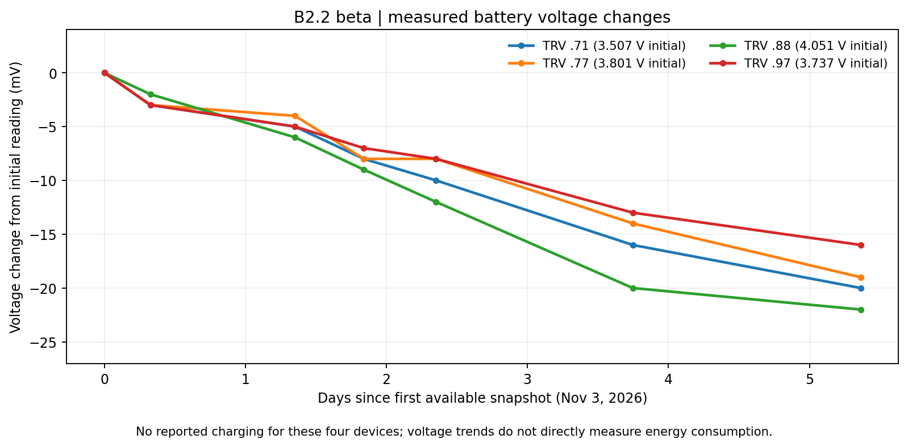

# Shelly TRV Gen1 – Firmware Patcher

**An independent firmware patcher for the Shelly TRV Gen1 (SHTRV-01), developed to investigate severe battery drain and improve firmware reliability.**


> **B2.2 Beta – November 2026**
>
> During more than six days of hardware testing, the severe battery depletion previously documented with original Shelly firmware has not been observed in the regular B2.2 test fleet.
>
> **Known issue:** Unexpected automatic reboots have occurred on several devices. Their cause remains under investigation.
>
> B2.2 is beta firmware, not an officially supported Shelly release or a proven permanent solution to every battery-drain issue.

## Why This Project Exists

The original Shelly TRV Gen1 can exhibit unusually high battery consumption. Some devices investigated in this project repeatedly discharged from nearly full to an indicated 0% within approximately six days.

Extensive firmware analysis identified several defects involving Wi-Fi power management, Beacon Recovery, host sleep-state handling, and resource management.

Rather than applying a single workaround, **B2.2 combines nine selected corrections** into one reproducible firmware build.

The goal is to preserve normal thermostat operation while addressing identified firmware defects that may contribute to excessive energy consumption.

## Battery Drain: Stock vs. B2.2

Historical Shelly Cloud data provides examples of severe battery depletion under original Stock firmware.

Our current B2.2 testing provides an initial comparison using the same hardware family, including several of the same devices.

| Observation | Historical Stock firmware | B2.2 Beta |
|---|---|---|
| Severe battery drain | Repeatedly observed within approximately 6 days | Not observed during the first 6+ days |
| Battery behavior | Rapid depletion in documented episodes | Relatively stable voltage in current snapshots |
| Beacon Recovery | Recurring problematic Recovery episodes documented | No comparable persistent Recovery loop visible in available observations |
| Thermostat operation | Normal functionality, but battery issues on some devices | Operational in testing, including recovery after unexpected restarts |
| Stability | Not established by the historical battery data | Unexpected automatic reboots observed |
| Assessment | Historical reference | Ongoing beta evaluation |

### Historical Stock Firmware



*Historical Shelly Cloud battery-percentage data from January and February 2026.*

Examples of documented discharge episodes:

| Device | Reported battery level | Duration |
|---|---|---:|
| TRV .11 | 95% → 0% | 6.33 days |
| TRV .77 | 95.5% → 0% | 5.79 days |
| TRV .226 | 95% → 0% | 6.08 days |

All devices were running original Shelly firmware during these historical episodes. The exact Stock firmware version is not independently recorded for every historical measurement.

### B2.2 Beta



*Battery-voltage measurements collected from November 3–9, 2026.*

Four continuously comparable devices showed the following voltage changes:

| Device | Voltage change |
|---|---:|
| TRV .71 | −20 mV |
| TRV .77 | −19 mV |
| TRV .88 | −22 mV |
| TRV .97 | −16 mV |

These readings cover approximately 5.4 days of available voltage snapshots. The overall B2.2 firmware test had exceeded six days by November 9.

**No comparable rapid battery depletion was observed.**

The graphs use different measurements: historical firmware-reported battery percentages versus current battery voltage. They are not directly equivalent measurements of remaining battery capacity.

There is also no simultaneous, matched Stock control group. The results are encouraging but do not establish a quantified improvement in battery lifetime or identify a single root cause.

## Current Hardware Test Status

**Last evaluated: November 9, 2026**

The regular B2.2 observation fleet consists of six Shelly TRV Gen1 devices.

A separate device running Stock firmware for MQTT security research is excluded from this evaluation. One B2.2 device was recharged during testing, so its battery measurements are evaluated from a separate baseline.

### Positive observations

- No historical Stock-like massive battery depletion during the first six days.
- Normal Wi-Fi and cloud connectivity observed during operation.
- Normal temperature measurement, calibration, and thermostat functions observed.
- No persistent Beacon-Recovery loop visible in the available B2.2 debug observations.
- Exact firmware reconstruction and validation successfully verified.

### Known reliability issue

Several test devices have restarted automatically without user intervention.

The underlying reset cause has not yet been established. A significant reboot-counter anomaly was also observed on one device.

Devices were reachable and operational again following their observed restarts, but uninterrupted thermostat control during each reset has not been independently verified.

**These restart issues are documented and remain under active investigation.**

B2.2 is therefore offered for voluntary beta testing, not as a fully validated stable firmware release.

## What Does B2.2 Change?

B2.2 integrates nine selected correction components:

| Component | Purpose |
|---|---|
| A1R | Host power-management lifecycle handling |
| C-C | Beacon-Recovery evidence validation |
| B2 | Sleep-inhibit counter synchronization |
| MQTT guard | Selected malformed MQTT PUBLISH input handling |
| WF200 3.18.0 | Updated official Silicon Labs radio firmware |
| Calibration Restore Guard | Prevent unintended repeated restore scheduling |
| P01 | Battery ADC resource cleanup |
| P02 | Synchronous I2C timeout cleanup |
| P03 | WLAN-GPIO interrupt-mask correction |

B2.2 does not globally disable Beacon Recovery and does not include the historical periodic mDNS bypass.

The specific contributions of these corrections to battery consumption have not been isolated.

For technical explanations, binary analysis and qualification details, see [Technical Details](docs/technical-details.md).

## Quick Start

### 1. Obtain the supported Stock firmware

The patcher supports only the exact Shelly TRV Gen1 firmware:

| Property | Value |
|---|---|
| Device | Shelly TRV Gen1 / SHTRV-01 |
| Stock version | 2.2.4 |
| Build | `20240619-130912/v2.2.4@ee290818` |
| GBL size | 1,106,384 bytes |

Place the original firmware file at:

```text
target/SHTRV-01_build_2.2.4.gbl
```

The original firmware must be obtained independently. No proprietary firmware is included in this repository.

### 2. Generate B2.2

On Linux or macOS:

```bash
python3 patch_firmware_v2.0.py
```

On Windows:

```powershell
py patch_firmware_v2.0.py
```

The patcher validates the exact Stock firmware and reconstructs the B2.2 artifacts locally.

Expected output:

```text
target/SHTRV-01_2.2.4_B2.2_EXPERIMENTAL.bin

target/SHTRV-01_2.2.4_B2.2_EXPERIMENTAL.gbl
```

The `EXPERIMENTAL` filenames are retained to preserve the verified B2.2 artifact identities. The current public testing classification is Beta.

### 3. Start the OTA server

On Linux or macOS:

```bash
sudo python3 ota_server.py
```

On Windows:

```powershell
py ota_server.py
```

The OTA server validates the generated B2.2 GBL before making it available over the local network.

**TCP port 80 is required for the supported OTA workflow.**

The server does not automatically install firmware.

### 4. Install on the TRV

Use the firmware URL displayed by the OTA server to initiate the update.

General OTA request format:

```text
http://<TRV-IP>/ota?url=http://<COMPUTER-IP>/SHTRV-01_2.2.4_B2.2_EXPERIMENTAL.gbl
```

For detailed installation instructions, including Windows, Linux, macOS and troubleshooting, see the [User Guide](USER_GUIDE.md).

## Firmware Verification

The patcher uses exact input and output validation. Unknown or modified firmware is rejected.

**Supported Stock GBL SHA-256**

```text
5c4a0b222a313350952f6b1200a855833402f168bd286090c23bd4d018ab918f
```

**Expected B2.2 GBL SHA-256**

```text
912983973a5467241397b9dd967ee0039440c7d77780a2a97ee494b1a507860c
```

The reconstructed application and GBL have been verified byte-for-byte against the qualified B2.2 reference artifacts.

The v2.0 patcher also passed its 18 automated regression tests.

The Shelly firmware version string remains unchanged at `2.2.4`. The `/status` endpoint alone cannot distinguish Stock from B2.2.

## Known Limitations

- **Automatic restarts:** Observed on several devices; root cause unknown.
- **Battery lifetime:** Initial six-day results are positive, but normal long-term battery lifetime has not yet been established.
- **Root cause:** Multiple firmware defects may contribute to excessive battery consumption. Their individual contributions have not been quantified.
- **Firmware support:** Only the exact supported Stock 2.2.4 build can be used.
- **Official support:** This is an independent community project, not a Shelly firmware release.

## Documentation

| Document | Description |
|---|---|
| [User Guide](USER_GUIDE.md) | Installation and troubleshooting |
| [Technical Details](docs/technical-details.md) | Firmware corrections and reverse engineering |
| [OTA Server](docs/ota_server.md) | Local OTA server and HTTP operation |
| [Testing](tests/README.md) | Reconstruction and qualification testing |
| [Security Policy](SECURITY.md) | Reporting security vulnerabilities |
| [Contributing](CONTRIBUTING.md) | Contribution requirements |

The detailed historical Stock-versus-B2.2 comparison and runtime investigation are documented separately from this overview.

## Firmware Distribution

**No original or modified Shelly firmware images are distributed by this repository.**

Users must obtain the exact supported Stock firmware independently and run the patcher locally.

The project contains original tooling and documentation, not redistributable Shelly firmware binaries.

## Disclaimer

This is an independent project and is not affiliated with, endorsed by, or supported by Shelly.

Firmware modification and installation carry risks, including device malfunction, interrupted heating control, loss of configuration, and device failure.

Use the tools and generated firmware at your own risk.

The original project code and documentation are licensed under the [MIT License](LICENSE). This license does not grant rights to proprietary Shelly firmware.