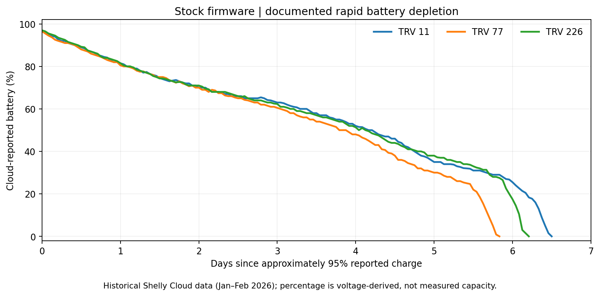
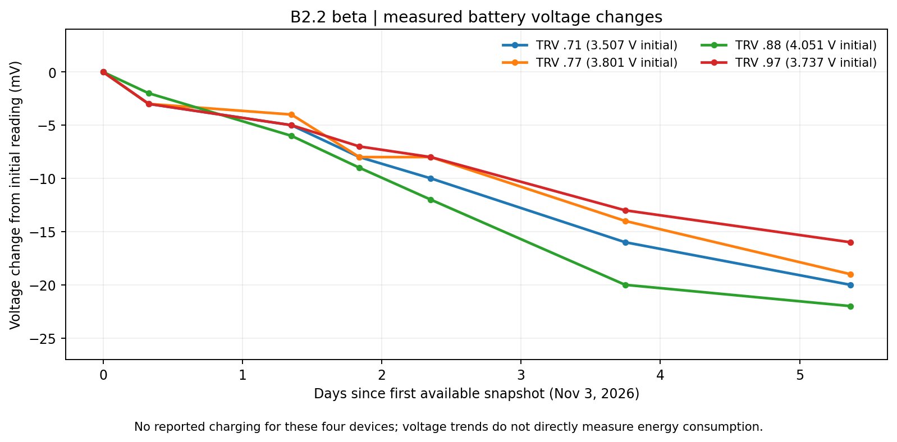

# Shelly TRV Gen1 B2.2 Beta – Long-Term Battery and Stability Report

**Firmware:** B2.2 Beta  
**Base firmware:** Shelly TRV Gen1 Stock 2.2.4  
**Device:** Shelly TRV Gen1 (`SHTRV-01`)  
**Test started:** November 2, 2026, approximately 18:55 CET  
**Last evaluated:** November 15, 2026, approximately 09:29 CET  
**Elapsed test duration:** Approximately 12.61 days  
**Comparable voltage data:** November 3–15, 2026 (11.51 days)  
**Test population:** Six B2.2 devices and one separate Stock reference  
**Status:** Ongoing long-term evaluation

> **Observation period:** This update covers approximately 12.6 days since deployment, not 14 completed 24-hour days. The initial six-day milestone remains documented as an intermediate result.

---

## 1. Executive Summary

Six Shelly TRV Gen1 devices have been monitored with integrated B2.2 Beta firmware since November 2, 2026.

After approximately 12.6 days of testing, the severe rapid battery depletion previously documented under original Shelly firmware has not recurred as a complete discharge to an indicated 0% in the regular B2.2 test fleet.

Four devices (.71, .77, .88 and .97) have comparable battery-voltage measurements spanning approximately 11.51 days.

Their observed voltage changes were:

| Device | Voltage change |
|---|---:|
| TRV .71 | −41 mV |
| TRV .77 | −98 mV |
| TRV .88 | −39 mV |
| TRV .97 | −29 mV |

Three devices continued to show relatively gradual voltage declines.

**TRV .77 requires additional observation.** Between November 11 and November 15, its reported battery voltage decreased by 75 mV, significantly more than during the preceding observation period.

A separate device running original Stock 2.2.4 firmware (.234) continued to exhibit frequent Beacon-Recovery messages. Its cumulative Beacon error counter reached 14,264 by November 15.

The Stock device also showed a larger voltage decline than three of the four continuously comparable B2.2 devices. However, it is not a matched control and cannot establish a quantified improvement in battery lifetime.

**Unexpected automatic restarts remain an unresolved reliability issue** on several B2.2 devices.

Overall, the battery observations are encouraging, but B2.2 remains experimental Beta firmware.

---

## 2. Background and Objective

The original Shelly TRV Gen1 has exhibited unusually high battery consumption on some devices.

Historical measurements documented repeated cases in which the firmware-reported battery level dropped from approximately 95% to 0% within roughly six days.

The broader investigation identified several firmware behaviors and defects involving:

- Host power-management lifecycle handling
- Beacon-Recovery decision logic
- Sleep-inhibit synchronization
- WF200 radio firmware
- Calibration restore handling
- Peripheral resource management

B2.2 integrates nine selected correction components into a reproducible firmware build.

This evaluation addresses three practical questions:

1. Does the historical rapid battery-depletion pattern recur during B2.2 testing?
2. How does the reported battery voltage develop over an extended observation period?
3. Are there runtime-stability problems that must be disclosed to potential Beta testers?

The evaluation does not attempt to attribute improvements to a single correction or establish the complete historical root cause of battery drain.

---

## 3. Test Configuration

### 3.1 B2.2 deployment

The regular B2.2 test fleet was deployed on November 2, 2026, at approximately 18:55 CET.

| Device | Firmware | Evaluation role |
|---|---|---|
| TRV .11 | B2.2 | Beta fleet; later voltage baseline |
| TRV .61 | B2.2 | Beta fleet; recharge discontinuity |
| TRV .71 | B2.2 | Continuous comparable voltage series |
| TRV .77 | B2.2 | Continuous comparable voltage series |
| TRV .88 | B2.2 | Continuous comparable voltage series |
| TRV .97 | B2.2 | Continuous comparable voltage series |
| TRV .234 | Stock 2.2.4 | Separate reference observation |

TRV .234 is not included in the regular B2.2 fleet.

It was used for a different research workload and does not represent a matched control under identical operating conditions.

### 3.2 Battery charging

Charging events and early voltage discontinuities affect the comparability of TRV .11 and TRV .61.

Their measurements must not be combined into one uninterrupted November 3–15 discharge curve.

Both devices remain included in operational and stability monitoring.

### 3.3 Firmware identification

B2.2 preserves the original Shelly firmware identity:

```text
20240619-130912/v2.2.4@ee290818
```

Consequently, the `/status` version string alone cannot distinguish Stock firmware from B2.2.

The firmware assignment is based on the documented deployment and verified locally generated firmware artifacts.

**Qualified B2.2 GBL SHA-256:**

```text
912983973a5467241397b9dd967ee0039440c7d77780a2a97ee494b1a507860c
```

---

## 4. Measurement Sources and Methodology

The evaluation combines historical Shelly Cloud battery records with timestamped device snapshots.

### 4.1 Historical Shelly Cloud exports

Historical battery-percentage measurements from January and February 2026 document repeated rapid-discharge episodes under original Shelly firmware.

These records are firmware-reported percentages, not direct electrical energy measurements.

The exact original firmware version was not independently recorded for every historical episode.

### 4.2 Device snapshots

The ongoing evaluation uses timestamped snapshots collected through available device HTTP interfaces:

```text
/status
/stats
/debug/log
```

Depending on endpoint support, the collected data includes:

- Battery voltage
- Firmware-reported battery percentage
- Device uptime
- Reboot and reconnect counters
- Desired and calculated real Beacon Skip
- Beacon errors and missed-beacon counters
- Valve motor step counters
- WLAN and cloud connectivity
- Recent debug messages

### 4.3 Observation periods

Three separate observation intervals are relevant.

| Measurement | Period | Duration |
|---|---|---:|
| B2.2 deployment | Nov 2–15, 2026 | Approximately 12.61 days |
| Comparable voltage snapshots | Nov 3–15, 2026 | Approximately 11.51 days |
| Initial six-day milestone | Nov 2–9, 2026 | Approximately 6.46 days |

The periods must not be treated as identical.

### 4.4 Measurement limitations

Battery voltage is affected by instantaneous electrical load, battery chemistry, temperature and device operating conditions.

The reported battery percentage is derived from firmware measurements and is not a direct measurement of consumed energy.

Neither percentage nor voltage alone establishes:

- Average electrical current
- Total energy consumption
- Remaining usable battery capacity
- Expected battery lifetime

The available debug excerpts cover limited recent history rather than the complete observation period.

---

## 5. Historical Stock Battery-Drain Evidence

Historical Shelly Cloud records contain several rapid battery-depletion episodes under original firmware.

| Device | Historical interval | Reported battery change | Duration |
|---|---|---|---:|
| TRV .11 | Jan 5–11, 2026 | Approximately 95% → 0% | 6.33 days |
| TRV .226 | Jan 5–11, 2026 | Approximately 95% → 0% | 6.08 days |
| TRV .11 | Jan 24–30, 2026 | Near-full → 0% | 6.42 days |
| TRV .77 | Jan 28–Feb 3, 2026 | Approximately 95% → 0% | 5.79 days |
| TRV .226 | Feb 14–20, 2026 | Near-full → 0% | 6.46 days |

These observations demonstrate that rapid firmware-reported battery depletion occurred repeatedly on selected devices.

They do not establish the exact electrical energy consumed or represent a simultaneous matched control group for B2.2.

### Historical battery chart



*Historical firmware-reported battery percentages from January and February 2026. These measurements are not directly equivalent to the current voltage-based evaluation.*

---

## 6. B2.2 Battery Results

### 6.1 Latest device measurements

Snapshot: November 15, 2026, approximately 09:29 CET.

| Device | Reported battery | Voltage | Uptime | Reboot counter |
|---|---:|---:|---:|---:|
| TRV .11 | 100% | 4.113 V | ~1.57 days | 8 |
| TRV .61 | 99% | 4.097 V | ~3.47 days | 37 |
| TRV .71 | 40% | 3.466 V | ~7.03 days | 65 |
| TRV .77 | 77% | 3.703 V | ~1.89 hours | 7 |
| TRV .88 | 99% | 4.012 V | ~3.25 days | 3 |
| TRV .97 | 78% | 3.708 V | ~12.60 days | 1 |
| TRV .234 (Stock) | 99% | 3.895 V | ~11.63 days | 3 |

All seven devices reported active WLAN and Shelly Cloud connections when the snapshot was collected.

### 6.2 November 3–15 voltage development

Four B2.2 devices have comparable measurements across approximately 11.51 days without a documented charging discontinuity.

| Device | Nov 3 | Nov 11 evening | Nov 15 | Total change |
|---|---:|---:|---:|---:|
| TRV .71 | 3.507 V | 3.474 V | 3.466 V | −41 mV |
| TRV .77 | 3.801 V | 3.778 V | 3.703 V | **−98 mV** |
| TRV .88 | 4.051 V | 4.022 V | 4.012 V | −39 mV |
| TRV .97 | 3.737 V | 3.717 V | 3.708 V | −29 mV |

The corresponding average voltage changes are:

| Device | Average observed voltage change |
|---|---:|
| TRV .71 | −3.56 mV/day |
| TRV .77 | −8.52 mV/day |
| TRV .88 | −3.39 mV/day |
| TRV .97 | −2.52 mV/day |

These values describe observed voltage trends only. They are not direct measurements of current consumption or battery capacity.

### 6.3 TRV .77 – Change in voltage trend

TRV .77 showed a relatively gradual voltage decline during the initial observation period.

Between November 3 and November 11, voltage changed from 3.801 V to 3.778 V, a difference of 23 mV.

Between November 11 and November 15, voltage changed from 3.778 V to 3.703 V, a further decrease of 75 mV.

The device also showed a recent restart before the November 15 measurement.

The currently available evidence does not establish whether the voltage change represents sustained increased battery consumption or a temporary measurement/load effect.

Further snapshots are required before classifying this behavior as renewed battery drain.

### 6.4 Devices with separate voltage baselines

TRV .11 and TRV .61 cannot be evaluated across the same uninterrupted November 3–15 baseline.

Their later reference measurements show:

| Device | Reference measurement | Nov 15 | Change |
|---|---:|---:|---:|
| TRV .11 | Nov 4: 4.151 V | 4.113 V | −38 mV |
| TRV .61 | Nov 5: 4.141 V | 4.097 V | −44 mV |

These measurements provide additional information about the ongoing test but should not be combined with the four-device continuous series.

### 6.5 Historical six-day milestone

The initial November 3–9 comparison produced the following voltage changes:

| Device | Voltage change |
|---|---:|
| TRV .71 | −20 mV |
| TRV .77 | −19 mV |
| TRV .88 | −22 mV |
| TRV .97 | −16 mV |

The original chart covers only November 3–9, 2026.



*Historical intermediate chart. The figure has not yet been extended to include the November 15 measurements.*

### 6.6 Battery assessment

At approximately 12.6 days since deployment, none of the six B2.2 devices has shown a documented complete recurrence of the selected historical near-full-to-zero rapid battery-depletion pattern.

Three continuously comparable devices (.71, .88 and .97) continue to show relatively gradual voltage declines.

TRV .77 requires additional monitoring because its recent voltage trend differs substantially from the earlier period.

The results do not yet prove:

- A quantified battery-lifetime improvement
- Reduced average electrical current
- A permanent solution to battery drain
- The contribution of each individual firmware correction
- A single confirmed root cause of historical rapid depletion

---

## 7. Beacon-Recovery Observations

The original investigation documented recurring messages of the form:

```text
Beacon skip error! Attempt recovery
```

On affected Stock devices, these messages could appear approximately once per minute.

B2.2 includes the C-C correction, which addresses identified problems in the evidence used for Beacon-Recovery decisions.

The correction does not globally disable Beacon Recovery.

### 7.1 November 15 measurements

| Device | Desired Skip | Real Skip | Current Beacon error counter |
|---|---:|---:|---:|
| TRV .11 B2.2 | 20 | 18 | 0 |
| TRV .61 B2.2 | 15 | 13 | 0 |
| TRV .71 B2.2 | 20 | 17 | 0 |
| TRV .77 B2.2 | 20 | 17 | 0 |
| TRV .88 B2.2 | 20 | 12 | 0 |
| TRV .97 B2.2 | 20 | 16 | 0 |
| TRV .234 Stock | 20 | 2 | **14,264** |

No comparable persistent Beacon-Recovery loop was identified in the available recent B2.2 debug excerpts.

A current Beacon error counter of zero does not prove that no Recovery event occurred throughout the entire test period.

Counters may be cleared or reinitialized, and the debug excerpts contain only limited recent history.

### 7.2 Separate Stock observation

TRV .234 continued to show repeated Beacon-Recovery messages under original Stock 2.2.4 firmware.

Between November 11 and November 15, its cumulative Beacon error counter increased from 9,189 to 14,264.

This corresponds to 5,075 additional counted errors over approximately 3.52 days, or roughly 60 per hour.

Its reported battery voltage changed as follows:

| Measurement | Value |
|---|---:|
| Nov 3 | 4.024 V |
| Nov 11 evening | 3.933 V |
| Nov 15 | 3.895 V |
| Total change | −129 mV |

The motor `steps_counter` remained at 11,579 across the available comparison snapshots.

The observations indicate a persistent Beacon-Recovery pattern alongside a relatively pronounced voltage decline.

However, the data does not establish a causal relationship between these observations.

TRV .234 was not operated under conditions identical to the regular B2.2 fleet.

---

## 8. Stability and Unexpected Reboots

Unexpected automatic restarts remain an important unresolved reliability issue in the B2.2 test fleet.

Several devices restarted without manual intervention during the observation period.

The available snapshots identify changes in uptime and reboot counters but do not provide continuous event recordings.

### 8.1 Observed stability status

| Device | Observation |
|---|---|
| TRV .11 | Automatic restarts observed |
| TRV .61 | Automatic restarts observed; unusually large reboot-counter change |
| TRV .71 | Automatic restart observed; unusually large reboot-counter change |
| TRV .77 | Automatic restarts observed, including a recent restart |
| TRV .88 | Automatic restarts observed |
| TRV .97 | No restart indicated by the available measurements since deployment |

### 8.2 Reboot-counter observations

The following counter changes were recorded:

| Device | Earlier measurement | Later measurement |
|---|---:|---:|
| TRV .61 | 4 (Nov 11) | 37 (Nov 15) |
| TRV .71 | 1 (Nov 7) | 65 (Nov 9) |

These changes must not be interpreted as independently confirmed numbers of physical resets.

The available snapshots do not establish the exact number of individual restarts occurring between collection times.

### 8.3 Operational impact

After the observed restarts, affected devices were reachable again in subsequent measurements.

However, the available telemetry does not establish whether temperature regulation remained uninterrupted during every reboot.

The cause of the automatic restarts remains unknown.

**This issue is significant for heating applications and must be disclosed to potential Beta testers.**

A separate GitHub issue will document the detailed investigation and subsequent technical findings.

---

## 9. Stock Reference Device: Limitations

TRV .234 provides a useful additional observation of original Stock 2.2.4 behavior.

During the available comparison period, it showed:

- A persistent approximately once-per-minute Beacon-Recovery pattern
- A cumulative Beacon error counter of 14,264
- A voltage decline of 129 mV
- No additional motor steps in the available snapshots

Nevertheless, the Stock observation does not constitute a matched experimental control.

The device differs in workload, motor activity and battery conditions.

Its measurements therefore cannot independently establish how much battery life B2.2 improves.

If the device is later assigned to a different firmware test, the original Stock observation series must be treated as historical data ending at that change.

---

## 10. Interpretation and Evidence Limitations

The principal limitations of this evaluation are:

1. Historical Stock evidence primarily uses firmware-reported battery percentages, whereas current B2.2 testing primarily compares voltage.
2. The separate Stock device does not provide a matched control under identical conditions.
3. Charging and voltage discontinuities affect the comparability of TRV .11 and TRV .61.
4. Valve movements, WLAN conditions, temperature, load and battery characteristics vary between devices.
5. Reported battery voltage cannot be converted directly into electrical energy consumption or expected battery lifetime.
6. Available debug excerpts do not cover the complete observation period.
7. Reboots and counter reinitialization can interrupt the continuity of diagnostic measurements.
8. Sparse snapshots cannot reconstruct every individual reboot.
9. The integrated B2.2 correction set prevents attributing observed effects to individual components.
10. TRV .77 has an unexplained recent voltage decline requiring continued monitoring.

These limitations constrain the conclusions but do not invalidate the observations.

---

## 11. Beta Classification

B2.2 remains classified as **Beta**.

The integrated firmware has been reproducibly reconstructed, technically qualified and operated on physical devices for approximately 12.6 days.

The battery observations remain encouraging, and no documented complete recurrence of the selected historical rapid-discharge episodes has been observed.

However:

- Normal long-term battery lifetime has not yet been established.
- TRV .77 shows a new voltage trend requiring investigation.
- Unexpected automatic restarts remain unresolved.
- The precise causes of the observed behavior have not been established.

**B2.2 must not be presented as a fully validated stable firmware release.**

Firmware installation and testing remain voluntary and experimental.

---

## 12. Next Observation Steps

### 12.1 Continue unchanged fleet monitoring

Where practical, the six existing B2.2 test devices should remain on the same firmware and WLAN configuration.

Continue collecting:

- Battery voltage and reported percentage
- Uptime
- Reboot and reconnect counters
- Beacon-Recovery statistics
- Valve motor activity
- WLAN and cloud connectivity
- Available debug messages

### 12.2 Monitor TRV .77

Compare upcoming voltage measurements with the November 15 baseline of 3.703 V.

Determine whether the recent faster decline continues or whether subsequent measurements return to a slower trend.

Avoid attributing the voltage change to a specific firmware mechanism without supporting evidence.

### 12.3 Continue stability observations

Record any additional unexpected restarts.

The detailed technical investigation of the restart behavior is documented separately from this battery and stability evaluation.

### 12.4 Extend battery testing

Continue beyond the current 12.6-day milestone.

Longer observation periods and, where practical, matched control measurements or direct electrical current measurements would support stronger conclusions.

---

## 13. Summary of Findings

| Research question | Result as of November 15, 2026 |
|---|---|
| Does B2.2 reconstruct reproducibly? | Yes |
| Has B2.2 operated on physical devices beyond 12 days? | Yes |
| Has the historical near-full-to-zero depletion pattern been documented in the B2.2 fleet during this period? | No |
| Do three continuously comparable B2.2 devices show gradual voltage declines? | Yes |
| Does TRV .77 show a recent faster voltage decline? | Yes |
| Does the separate Stock .234 device show persistent Beacon Recovery? | Yes |
| Is a comparable persistent Recovery loop visible in the sampled B2.2 debug logs? | No |
| Have unexpected automatic restarts occurred? | Yes |
| Has the cause of the restarts been established? | No |
| Has a quantified battery-life improvement been proven? | No |
| Has the complete historical battery-drain root cause been established? | No |

---

## 14. Conclusion

The B2.2 test fleet has reached approximately 12.6 days of operation since deployment.

During this period, the severe historical rapid battery-depletion pattern has not recurred as a documented complete discharge to an indicated 0% among the six regular B2.2 devices.

Three continuously comparable devices show relatively gradual voltage declines. TRV .77 has exhibited a recent faster decline that must be monitored further.

The separate Stock 2.2.4 device continues to show frequent Beacon-Recovery activity and a larger measured voltage decline than three of the comparable B2.2 devices. These observations are not a controlled demonstration of cause or battery-life improvement.

Several B2.2 devices have restarted unexpectedly. This remains an important unresolved reliability limitation.

**The available battery observations support continued investigation and voluntary Beta testing. They do not establish a permanent battery-drain fix or fully validated firmware stability.**

---

## Related Documentation

- [Project Overview](../README.md)
- [User Guide](../USER_GUIDE.md)
- [Technical Details](technical-details.md)
- [Testing and Validation](../tests/README.md)
- [OTA Server](ota_server.md)
