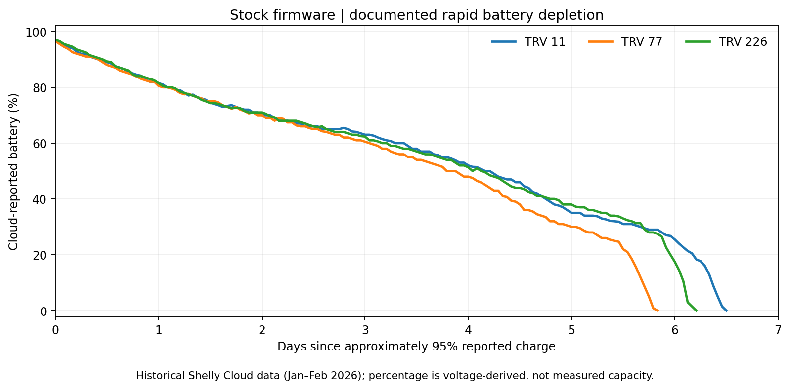
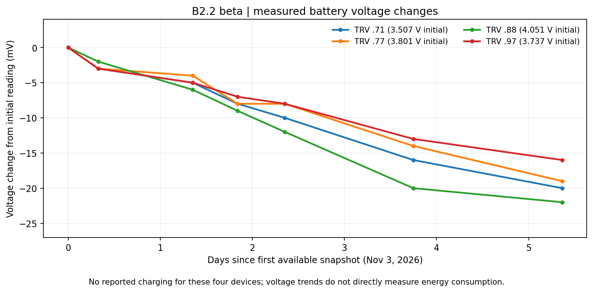

# Shelly TRV Gen1 B2.2 Beta – Six-Day Battery and Stability Report

**Firmware:** B2.2 Beta  
**Base firmware:** Shelly TRV Gen1 Stock 2.2.4  
**Device:** Shelly TRV Gen1 (`SHTRV-01`)  
**Deployment:** November 2, 2026, approximately 18:55 CET  
**Evaluation:** November 9, 2026, approximately 06:05 CET  
**Elapsed deployment time:** Approximately 6 days, 11 hours (6.46 days)  
**Test population:** Six regular B2.2 devices  
**Report status:** Initial six-day milestone; monitoring continues

---

## 1. Executive Summary

The first six-day evaluation of the integrated Shelly TRV Gen1 B2.2 firmware has been completed.

**The most important battery observation is that the severe rapid depletion previously documented on original Shelly firmware has not recurred in the regular B2.2 test fleet during the initial observation period.**

Four devices with comparable battery-voltage snapshots showed decreases of only 16–22 mV between November 3 and November 9, 2026.

Historical Shelly Cloud records from January and February 2026 contain several original-firmware discharge episodes reaching an indicated battery level of 0% within approximately 5.8–6.5 days.

These findings are encouraging, but the measurements are not directly equivalent. The historical records primarily contain firmware-reported battery percentages, whereas the B2.2 analysis uses measured device voltage. No simultaneous matched Stock control group was operated under equivalent conditions.

A separate reliability issue was also identified: several B2.2 devices restarted automatically without user intervention. The cause of these resets remains unknown, and one device exhibited an unusually large reboot-counter increase.

**Overall assessment:** B2.2 has passed its first battery-observation milestone with encouraging results. The firmware remains classified as Beta because its long-term battery lifetime and stability have not yet been established.

---

## 2. Background and Objective

The original Shelly TRV Gen1 has exhibited unusually high battery consumption on some devices.

During the broader firmware investigation, several firmware defects and potentially energy-relevant mechanisms were identified in areas including:

- Host power-management lifecycle handling
- Beacon-Recovery decision logic
- Sleep-inhibit synchronization
- WF200 radio firmware
- Peripheral resource cleanup
- Calibration restore behavior

The integrated B2.2 firmware includes nine selected qualified correction components.

The purpose of this report is not to attribute the historical battery drain to one specific correction.

Instead, it evaluates three practical questions:

1. Does the previously observed severe rapid battery depletion recur during the initial B2.2 test period?
2. Do the available voltage measurements show a continuous or abnormal decline?
3. Are there any significant runtime-stability problems that must be disclosed before further beta testing?

---

## 3. Test Configuration

### 3.1 B2.2 deployment

The regular B2.2 test fleet was deployed on November 2, 2026, at approximately 18:55 CET.

The monitored devices were:

| Device | Firmware | Included in battery evaluation |
|---|---|---|
| TRV .11 | B2.2 | Yes |
| TRV .61 | B2.2 | Yes, with charging discontinuity |
| TRV .71 | B2.2 | Yes |
| TRV .77 | B2.2 | Yes |
| TRV .88 | B2.2 | Yes |
| TRV .97 | B2.2 | Yes |
| TRV .234 | Stock 2.2.4 | No |

TRV .234 was used for separate MQTT security testing and was explicitly excluded from the regular B2.2 fleet evaluation.

Its firmware, workload and test conditions make it unsuitable as a clean, matched control for this battery assessment.

### 3.2 Battery charging

TRV .61 was recharged during the observation period.

Measurements before and after that charging event cannot be treated as a single uninterrupted battery-discharge curve.

The device remains included in runtime and stability monitoring.

### 3.3 Firmware identification

B2.2 preserves the native Shelly firmware identity:

```text
20240619-130912/v2.2.4@ee290818
```

Consequently, the `/status` version string alone cannot distinguish Stock 2.2.4 from B2.2.

The integrated firmware is identified by its qualified reconstruction and artifact hashes.

**B2.2 GBL SHA-256:**

```text
912983973a5467241397b9dd967ee0039440c7d77780a2a97ee494b1a507860c
```

---

## 4. Measurement Sources and Methodology

The evaluation combines three evidence sources.

### Historical Shelly Cloud exports

Historical battery-percentage records from January and February 2026 provide examples of rapid depletion under original Shelly firmware.

These measurements are not direct current or energy measurements.

The exact Stock firmware build was not independently documented for every historical observation.

### B2.2 device snapshots

The B2.2 evaluation uses timestamped snapshots collected through the device's available HTTP interfaces, including:

```text
/status
/stats
/debug/log
```

Depending on endpoint support, the snapshots contain information such as:

- Battery voltage and reported percentage
- Device uptime
- Reboot counter
- Reconnect counter
- Desired and calculated real Beacon Skip
- Beacon error and missed-beacon counters
- Available recent debug messages
- WLAN, cloud and calibration state

### Observation period

The complete deployment interval was approximately 6.46 days.

The available voltage-snapshot series used for the detailed November 3–9 comparison covers approximately 5.36 days.

These periods must not be presented as equivalent.

### Measurement boundaries

Battery percentage is derived from voltage and is not a coulomb count.

Voltage is affected by load, temperature, battery characteristics and measurement conditions.

Neither reported percentage nor voltage directly measures current consumption or accumulated energy use.

---

## 5. Historical Stock Battery-Drain Evidence

Historical Shelly Cloud data contains multiple rapid-discharge episodes under original firmware.

Examples include:

| Device | Historical period | Reported battery change | Duration |
|---|---|---|---:|
| TRV .11 | Jan 5–11, 2026 | Approximately 95% → 0% | 6.33 days |
| TRV .226 | Jan 5–11, 2026 | Approximately 95% → 0% | 6.08 days |
| TRV .11 | Jan 24–30, 2026 | Near-full charge → 0% | 6.42 days |
| TRV .77 | Jan 28–Feb 3, 2026 | Approximately 95% → 0% | 5.79 days |
| TRV .226 | Feb 14–20, 2026 | Near-full charge → 0% | 6.46 days |

These records demonstrate that severe depletion occurred repeatedly rather than as one isolated incident.

However, the displayed percentage represents the firmware's battery estimate. It must not be interpreted as a direct measurement of energy removed from the cells.

The historical devices were running original Shelly firmware, but they were not necessarily all using the exact Stock 2.2.4 build.

### Historical battery chart



*Historical battery-percentage measurements. The figure is illustrative of selected documented rapid-discharge episodes and is not a simultaneous control for the B2.2 evaluation.*

---

## 6. B2.2 Battery Results

### 6.1 Current device measurements

The November 7 and November 9 snapshots provide the following battery-voltage comparison:

| Device | Nov 7 | Nov 9 | Voltage change | Reported battery on Nov 9 |
|---|---:|---:|---:|---:|
| TRV .11 | 4.140 V | 4.130 V | −10 mV | 100% |
| TRV .61 | 4.123 V | 4.117 V | −6 mV | 100% |
| TRV .71 | 3.491 V | 3.487 V | −4 mV | 44% |
| TRV .77 | 3.787 V | 3.782 V | −5 mV | 89% |
| TRV .88 | 4.031 V | 4.029 V | −2 mV | 99% |
| TRV .97 | 3.724 V | 3.721 V | −3 mV | 80% |

The observed interval is approximately 38 hours and 48 minutes.

No sudden, severe voltage decline is visible in this comparison.

### 6.2 Longer comparable voltage series

Four devices with no documented charging event in the available November 3–9 snapshot sequence show:

| Device | Nov 3 | Nov 9 | Absolute change |
|---|---:|---:|---:|
| TRV .71 | 3.507 V | 3.487 V | −20 mV |
| TRV .77 | 3.801 V | 3.782 V | −19 mV |
| TRV .88 | 4.051 V | 4.029 V | −22 mV |
| TRV .97 | 3.737 V | 3.721 V | −16 mV |

All four devices show relatively small voltage changes across approximately 5.36 days of available snapshots.

These are observed voltage differences, not direct measurements of remaining battery capacity.

### B2.2 voltage chart



*Voltage change relative to the first available November 3 snapshot. TRV .61 is excluded from the continuous trend because of charging; TRV .11 is excluded from this chart because its early voltage readings increased.*

### 6.3 Assessment of the battery results

The results support the following observations:

- The regular fleet remained operational beyond the six-day deployment milestone.
- No historically comparable rapid battery depletion was detected during the period.
- The four longer comparable voltage series remained relatively flat.
- There is currently no evidence of the same pronounced depletion pattern seen in the selected historical Stock episodes.

The results do **not** establish:

- A guaranteed increase in battery lifetime
- A quantified reduction in average current consumption
- A fully restored normal battery lifetime
- Which of the nine corrections contributed most
- A conclusively proven historical root cause

A longer observation period and preferably controlled electrical measurements would be required for those conclusions.

---

## 7. Beacon-Recovery Observations

The original investigation documented recurring messages similar to:

```text
Beacon skip error! Attempt recovery
```

On affected Stock configurations, Recovery could recur approximately once per minute.

The B2.2 C-C correction addresses identified problems in the validity of the host's Recovery decision evidence.

It does not globally disable Beacon Recovery.

### November 9 snapshot

| Device | Desired Skip | Real Skip | Current Beacon error counter |
|---|---:|---:|---:|
| TRV .11 | 20 | 18 | 0 |
| TRV .61 | 15 | 13 | 0 |
| TRV .71 | 20 | 19 | 0 |
| TRV .77 | 20 | 20 | 0 |
| TRV .88 | 20 | 19 | 0 |
| TRV .97 | 20 | 17 | 0 |

No recurring Beacon-Recovery message was identified in the available recent debug excerpts for the six regular B2.2 devices.

However, the debug excerpts cover only limited recent history.

Additionally, some counters may be reset by restarts or state reinitialization.

**A current Beacon error counter of zero is not proof that no Recovery event occurred throughout the complete six-day period.**

The available observations support the absence of a visible persistent Recovery loop in the sampled data.

---

## 8. Stability and Unexpected Reboots

The strongest unresolved B2.2 reliability finding is the occurrence of unexpected automatic reboots.

The operator confirmed that the relevant observed restarts were not manually initiated.

### 8.1 Reboot-counter development

| Device | Nov 3 counter | Nov 9 counter | Recorded change |
|---|---:|---:|---:|
| TRV .11 | 2 | 6 | +4 |
| TRV .61 | 2 | 3 | +1 |
| TRV .71 | 1 | 65 | +64 |
| TRV .77 | 1 | 6 | +5 |
| TRV .88 | 1 | 2 | +1 |
| TRV .97 | 1 | 1 | 0 |

The recorded changes must be interpreted alongside device uptime and other available diagnostics.

### 8.2 TRV .71 anomaly

TRV .71 is particularly noteworthy.

Between November 7 and November 9, its reboot counter changed from 1 to 65.

The latest available uptime places a restart at approximately November 8, 08:42 CET.

The user confirmed that this restart was not manually initiated.

However, the available uptime data establishes at least one restart, **not 64 independently confirmed restart events**.

Possible explanations include a rapid sequence of resets or a separate inconsistency in reboot-counter handling.

The current evidence does not distinguish between those possibilities.

### 8.3 Other observed restarts

Additional non-manual restarts were documented on devices including TRV .11, .61, .77 and .88.

Notable observed restart times include:

| Device | Approximate time (CET) | Evidence |
|---|---|---|
| TRV .11 | Nov 5, 09:10 | Uptime and counter change; user confirmed no manual restart |
| TRV .11 | Nov 5, 22:00 | Uptime and counter change |
| TRV .77 | Nov 5, 22:42 | Uptime and counter change |
| TRV .88 | Nov 6, 01:37 | Uptime and counter change |
| TRV .61 | Nov 7, 02:41 | Uptime and counter change |
| TRV .77 | Nov 7, 07:36 | Most recent boot at the Nov 7 snapshot |
| TRV .71 | Nov 8, 08:42 | Uptime and counter anomaly; user confirmed no manual restart |
| TRV .11 | Nov 8, 16:54 | Most recent boot at the Nov 9 snapshot |

The table lists identifiable boot events and is not a complete reset-event log.

### 8.4 Reset-cause limitations

The existing `/status`, `/stats` and bounded debug snapshots do not provide a confirmed hardware reset cause.

The current observations therefore cannot establish whether the restarts resulted from:

- Watchdog timeout
- Software-triggered reset
- CPU exception or lockup
- Power-related reset
- Sleep/wake interaction
- A different firmware or hardware condition

It has not yet been demonstrated that the issue was introduced by B2.2 rather than already being present under some Stock conditions.

### 8.5 Functional impact

After the observed restarts, devices were again reachable and operational in subsequent snapshots.

However, the available telemetry does not prove that heating regulation was uninterrupted during every reboot.

The reliability issue must therefore remain open and be disclosed to beta testers.

---

## 9. Stock Control Device: Important Qualification

TRV .234 runs original Stock 2.2.4 and showed no comparable reboot-counter increase during the examined period.

It also exhibited numerous Beacon-Recovery events and a low calculated real Beacon Skip.

This contrast is technically interesting but does not constitute a controlled comparison.

TRV .234 was used for MQTT security testing under conditions that differ materially from the regular heating test fleet.

It must not be used as direct evidence that B2.2 introduces the reboot problem or that Stock 2.2.4 is generally more stable.

A properly matched control test would be required to establish such a difference.

---

## 10. Interpretation and Evidence Limitations

The principal limitations of this evaluation are:

1. **Historical versus current measurements:** Historical Stock evidence mainly uses firmware-reported battery percentage; B2.2 evidence includes voltage readings.
2. **No simultaneous matched control:** The comparison does not isolate firmware as the only changing variable.
3. **Charging interruption:** TRV .61 cannot be treated as one continuous discharge series.
4. **Different device activity:** Valve movements, room conditions and WLAN behavior may vary.
5. **Voltage is not energy:** Small voltage changes cannot be converted into precise battery-life estimates without additional information.
6. **Limited debug history:** Recent debug excerpts do not cover the complete six-day period.
7. **Counter persistence:** Reboots or reinitialization may affect counters.
8. **Unknown reset causes:** Existing snapshots do not establish whether restarts are Watchdog, software, exception or power related.
9. **Integrated correction set:** The test evaluates B2.2 as a whole and cannot attribute improvements to individual corrections.

These limitations do not invalidate the positive observations, but they constrain the conclusions.

---

## 11. Beta Classification

Based on the initial hardware results, B2.2 is classified as **Beta**.

This classification reflects:

- Successful deterministic reconstruction and technical qualification
- Successful installation and operation on physical hardware
- Encouraging initial battery observations
- No recurrence of the historical severe rapid-discharge pattern in the regular fleet during the first six days
- Known unresolved automatic restarts
- Incomplete long-term reliability and lifetime evidence

Beta classification is not a claim of stable production quality.

The unexpected reboot behavior must be clearly disclosed in release notes and user documentation.

---

## 12. Next Investigation Steps

### 12.1 Continue unchanged fleet monitoring

Where practical, existing B2.2 devices should remain on the same firmware and WLAN configuration.

Continue recording:

- Battery voltage and reported percentage
- Uptime
- Reboot and reconnect counters
- Beacon statistics
- Calibration and thermostat state
- Available debug logs

### 12.2 Investigate reset causes

Priority areas for firmware analysis include:

- EFM32 reset-cause acquisition (`RMU_RSTCAUSE`)
- Watchdog configuration and feed paths
- Reboot-counter storage and update semantics
- Sleep-entry and wake-up transitions
- Relevant interactions with the B2.2 corrections

Before changing firmware, existing Stock and B2.2 boot/reset paths should be compared statically.

### 12.3 Longer battery observation

Continue monitoring beyond the initial six-day milestone.

A multi-week observation period would provide stronger evidence on whether the historically observed rapid-depletion condition remains absent.

### 12.4 Controlled follow-up

If practical, future testing should include a matched Stock control and direct current-consumption measurements.

That would allow stronger conclusions about energy savings and potential causal mechanisms.

---

## 13. Summary of Findings

| Research question | Six-day result |
|---|---|
| Does B2.2 reconstruct exactly? | Yes, independently verified |
| Does B2.2 operate on physical hardware? | Yes |
| Did historical Stock-like rapid depletion recur? | Not observed |
| Were voltage trends relatively stable? | Yes, in the comparable snapshot series |
| Was a persistent Beacon-Recovery loop observed? | Not in available sampled B2.2 logs |
| Were unexpected automatic restarts observed? | Yes |
| Is the reset cause known? | No |
| Is long-term stability proven? | No |
| Is improved battery lifetime quantitatively proven? | No |
| Is the complete historical drain root cause proven? | No |

---

## 14. Conclusion

The first six-day B2.2 hardware evaluation has reached a significant milestone.

The regular test fleet did not exhibit the previously documented severe rapid battery depletion during the initial deployment interval.

Four comparable voltage series showed decreases of only 16–22 mV over approximately 5.36 days of available snapshots.

These observations provide encouraging evidence for the battery behavior of the integrated B2.2 firmware, but they do not constitute a controlled measurement of battery-life improvement.

At the same time, several devices experienced unexpected automatic restarts. The substantial reboot-counter change on TRV .71 is particularly important and requires further investigation before definitive statements about firmware reliability can be made.

**B2.2 is therefore released for continued voluntary Beta testing with the automatic-restart issue explicitly documented.**

The most defensible current conclusion is:

**The historical severe battery-depletion pattern has not recurred during the initial six-day B2.2 observation, while the underlying battery-drain root cause and the causes of unexpected device resets remain unresolved.**

---

## Related Documentation

- [Project Overview](../README.md)
- [User Guide](../USER_GUIDE.md)
- [Technical Details](technical-details.md)
- [Testing and Validation](../tests/README.md)
- [OTA Server](ota_server.md)